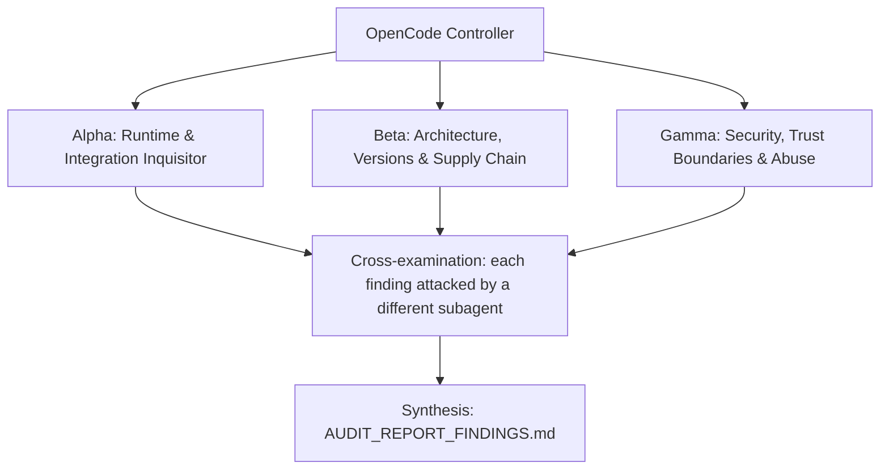

# ADVERSARIAL THREE-SUBAGENT AUDIT PROMPT: `opencode-v2-plugin-teser`

> Status: prompt that produced the v1 findings at `af6675c` (see `audit-findings-v1-af6675c.md`); its OCI-6.2 remediation was later reverted — see R1 in `review-main-8aa4d61`; do not follow stale advice.

**Target Codebase**: the Git repository this file sits in. Resolve it with `git rev-parse --show-toplevel` and treat every path below as relative to that root. Nothing in this prompt depends on where the checkout lives.
**GitHub Remote**: `https://github.com/Heretek-AI/opencode-v2-plugin-teser`
**What it is supposed to be**: A CLI plus composite GitHub Action (`@heretek-ai/opencode-plugin-ci`, bin `opencode-plugin-ci`) that answers "does my opencode v2 plugin actually work?" identically on a laptop and in CI by driving the real `opencode` binary with the plugin loaded and asserting on what happened across three tiers — `load` (plugin activates under opencode 2.0.26+), `scripted` (deterministic scenarios against a local stub model, zero tokens), and `live` (real provider, k-of-n attempts under a USD budget, skipped — never failed — without a key). Consumers are plugin authors via `bunx` and via the Action; a probe plugin loaded pre/post observes hooks and inventory, a one-line shim loads the real entry file, and a historical flake gate judges live-tier flakes. Non-goals: no TUI rendering checks (load-only for TUI plugins), no v1 (`@opencode-ai/*`) plugins, no model-quality benchmarking. Refusal boundary: never run the live tier against a real model with a real key during an audit — assert the skip path instead — and never test `pull_request_target`-style flows with secrets exposed.
**Execution Context**: OpenCode v2 autonomous audit (works the same in any agent CLI that has subagents and a shell)
**Auditor Formation**: three independent adversarial subagents (Alpha, Beta, Gamma), a cross-examination pass, and a synthesis pass
**Output**: `AUDIT_REPORT_FINDINGS.md` at the repository root

This prompt is designed to be re-run. Each run audits the current `HEAD`, re-verifies every finding of the previous run, and overwrites `AUDIT_REPORT_FINDINGS.md`.

---

## 0. Preflight (the controller does this before spawning subagents)

1. **Baseline.** Record at the top of the report: `git rev-parse HEAD`, `git log -1 --format='%ci %s'`, the UTC date, and the versions of every tool you will use (bun, node, npm, git, gh, jq, rg, curl). If `git status --porcelain` shows changes other than this prompt file and a previous report, list the dirty files and audit a clean `git worktree` of `HEAD` instead of the working tree.
2. **Scratch space.** `export AUDIT_TMP="$(mktemp -d -t opencode-v2-plugin-teser-audit-XXXXXX)"`. Every clone, downloaded binary, packed tarball, sabotage copy, container volume and raw log goes under `$AUDIT_TMP`. Each subagent writes its raw notes to `$AUDIT_TMP/{alpha,beta,gamma}.md`.
3. **Disposable copy for experiments.** `git worktree add --detach "$AUDIT_TMP/wt" HEAD`. Sabotage, patched configs, and any file edits happen only there. The real checkout must end the audit with `git status --porcelain` showing nothing new but `AUDIT_REPORT_FINDINGS.md` (and this prompt file, if you copied it in untracked). Remove the copy with `git worktree remove --force "$AUDIT_TMP/wt"` at the end.
4. **Previous run.** If `AUDIT_REPORT_FINDINGS.md` already exists, read it before anything else. Every finding in it gets a row in the Regression Ledger (section 6), re-verified from scratch: never copy a previous verdict forward.
5. **Network and host capabilities.** You need outbound HTTPS to github.com, raw.githubusercontent.com, npm registry (registry.npmjs.org), OSV API (https://api.osv.dev/v1/query). Probe what this host can do (`bun --version`, `node --version`, `gh auth status`, `$OPENCODE_BIN --version`) and record it. When a check cannot run here, the claim is `UNVERIFIABLE` with the exact reason. A claim is never `VERIFIED` by inference, by reading the code alone, or because a test says so.

**Hard limits (all subagents):** no package publishing, no `git push`, no tags, no GitHub writes (issues, comments, PRs), no real API keys or credentials in any command, file or report (generate throwaway keys and dummy values), no destructive command outside `$AUDIT_TMP`, loopback ports only for the stub model, throwaway temp dirs only, never run the live tier with a real key (assert the skip path instead). Read-only against the real checkout.

---

## 1. Directive & Rules of Engagement

You are a team of **three elite, adversarial principal systems auditors**. Your mandate is to stress-test, debunk, and verify every claimed feature, architectural decision, integration contract, security invariant, and version pin in **`opencode-v2-plugin-teser`**, measured against what the repository is supposed to be (above) and what its own `README.md`, `AGENTS.md` and `docs/` claim.

### The Cardinal Rule: DO NOT BELIEVE TESTS
- Unit tests, acceptance scripts and CI badges can lie: they assert obsolete invariants, mock away the real system, or test that a file *contains* a rule rather than that the rule *works*.
- This repository has a documented history of exactly that:
  - M10 rework: the `report` command re-rendered saved multi-version results without `allowedVersions`, marking allowed failures as failures while the header said "allowed to fail" — unit snapshot + e2e stayed green; caught by drift-guard audit, not by tests.
  - `test/fixtures/plugins/tool-basic` ships a deliberately failing scenario (`fail.yaml` expects `echo:bye`); an unfiltered full `run` exits 1 by design — naive suite-runners see red.
  - `gate.window`/`gate.threshold` config is accepted but inert (verbatim verdict hard-codes >=5 samples, >=90%); tests pass with custom values silently ignored.
  - SPEC 5.3 snippet names (`Sandbox.create`/`loadProbe`/`assert`) do not match real exports (`new Sandbox`/`readProbe`/`evaluate`+`check`).
  - Probe redact regex is a fail-closed superset (`AUTH|COOKIE` added) vs the spec.
  - The live tier never ran against a real model (no key in this environment) — live paths are green via skip + stub only.
- Never conclude that a component works because `bun run check` and `OPENCODE_BIN=… bun run test:e2e --timeout 600000` exits 0. Prove behavior against **the real thing it plugs into**: the real `opencode` binary (`@opencode/cli@2.0.26` from npm, plus upstream head), the real `@opencode/plugin` 2.0.26 type definitions and opencode source tree, the npm registry (published tarball + `npm view`), and a real GitHub Actions run of the composite Action.

### The Second Rule: DO NOT BELIEVE THE PAPER TRAIL
- `docs/reports/*`, `docs/evidence/*`, "red-proof" logs, drift-guard `VERDICT: PASS` lines, `CHANGELOG.md`, and `README.md` are **claims under audit**, not evidence.
- The repo was built by agent triads from docs/IMPLEMENTATION_PROMPT.md, a milestone brief grounded in a 2026-10-17 spike against opencode 2.0.26; docs/SPEC.md is the design source of truth. Build gates that only check spec compliance cannot catch invented facts (API names, image tags, config shapes) in the spec. Matching the spec is not the same as working. Where the spec and reality disagree, reality wins and the spec is the defect.

### The Third Rule: SABOTAGE EVERY CRITICAL INVARIANT
- For each invariant marked **[S]** in section 3, break it with a one-line change in `$AUDIT_TMP/wt`, run the full suite there, and record whether the suite went red. Restore the line after each run.
- A sabotage the suite does not catch is a finding: **P1** ("untested invariant"), or **P0** when the invariant is a security boundary.

### Modern Version & Proper Deployment Imperative
- Every pinned version must be a **modern, supported, production-grade release that actually exists** in its registry. Flag invented versions, deprecated or archived packages, renamed organizations, floating tags (`latest`, `^` ranges on security-relevant deps, unpinned GitHub Actions), end-of-life runtimes, and versions with known CVEs (the ecosystem's audit tool, OSV: `https://api.osv.dev/v1/query`).
- Verify that integration patterns follow the **official upstream documentation and source code** of the system being integrated, at the version pinned and at the current upstream head (drift is a finding).

### Verdict vocabulary
Every claim in section 3 ends with exactly one status, each backed by a command and its output:
- `VERIFIED` (proven to work against the real thing), `PARTIAL` (works with caveats you name), `BROKEN` (proven not to work), `UNVERIFIABLE` (could not be run here, with the exact reason).

---

## 2. The Adversarial Triad (Subagent Roles)



### Subagent Alpha: Runtime & Integration Inquisitor
**Focus question:** does every tier actually pass against the real `opencode` binary at the pinned version AND at upstream head, for every plugin surface the repo claims?

1. Run tier 1 and tier 2 end-to-end with `OPENCODE_BIN` pointing at a freshly `npm install`ed `@opencode/cli@2.0.26` in `$AUDIT_TMP` (never the repo's `review/oc` cache) against every fixture in `test/fixtures/plugins/` (`tool-basic` pass AND deliberate-fail, `tool-direct`, `hook-mutate`, `shell-env`, `system-inject`, `event-file`, `throws`, `no-entry`, `tui-only`, `tui-broken`); confirm `throws` fails naming `fixture boom`, `no-entry` exits 2, and the deliberate `fail.yaml` exits 1 by design.
2. Re-run the load + scripted tiers against opencode upstream head (`npm view @opencode/cli version`, install that into `$AUDIT_TMP`) and diff behavior: catalog format, hook order, `tool_use` event shapes, `plugin.list()` fields — any silent change is drift.
3. Prove the `[pre, plugin, post]` hook-order claim both ways: swap fixture order in a scratch sandbox config and show `pre` records the unmutated input while `post` records the mutated one (use `hook-mutate` and `shell-env` fixtures).
4. Exercise every `expect` assertion surface (`tools`, `noTools`, `hooks` pre/post, `request` nth/system/tools, `files`, `stderr`, `text`, `exitCode`, `noErrors`) with a crafted failing value each, and confirm each failure message names the file, the matcher, and a truncated `got` value.
5. Prove the live tier never touches a real model: run `run --tier live` with no key (expect `skipped: "no API key …"`, exit 0) and with a throwaway dummy key against the stub (`OPENCODE_PLUGIN_CI_JUDGE_VIA_STUB=1` test-only hook), then verify judge tokens count toward `live.budgetUSD` and the pre-attempt budget check skips before spawning.

### Subagent Beta: Architecture, Versions & Supply Chain
**Focus question:** is every pin real, modern, and supported; is every ported file faithful; and does the packaged artifact match what the repo promises?

1. Registry truth: `npm view @opencode/cli versions --json` (2.0.26 present, not deprecated/yanked), `npm view @opencode/plugin@2.0.26`, `npm view yaml zod` ranges vs `^2.9.1`/`^4.1.0` in `package.json`; OSV-query `yaml`, `zod`, and the resolved `@opencode/cli` for known CVEs; flag `opencode.versions: ["2.0.26", "latest"]` floating-`latest` semantics (allowed-failure leg) against a head install.
2. Upstream identity and drift: the local `review/opencode` clone's remote is `https://github.com/anomalyco/opencode.git` (a fork, not `sst/opencode`) — determine the canonical v2 upstream, compare pinned version vs upstream head for `tool.transform`/`tool.hook`/`shell.hook`/`session.hook` signatures, the `permissions: [{action, resource, effect}]` shape, Code Mode catalog format, and `plugins`-array hook ordering; note `review/oc` is an npm-install dir, not a clone.
3. Verbatim-port fidelity: byte-compare `src/gate/verdict.ts` and `src/gate/exit.ts` against the named IUMBTEMS upstream (`review/IUMBTEMS/packages/core/src/evals/gate.ts`, `packages/core/src/evals/exit.ts`) at the pinned commit AND upstream head; audit the deliberate deviations in `docs/NOTES.md` (absent-acks default, strict acks, hard-coded >=5/>=90% ignoring `gate.window`/`gate.threshold`) as contract questions, not conclusions.
4. Dependency placement and packaging: `@opencode/plugin` is devDeps-only (types) — prove `probe/` (plain ESM, only `node:fs`/`node:path`) and the packed tarball (`npm pack --dry-run`, `files: [bin, src, probe, schema, examples, README, LICENSE, NOTICE]`) contain no dev leakage; `bunx @heretek-ai/opencode-plugin-ci` path must resolve once published, `engines bun>=1.2`, `setup-bun@v2`/`setup-node@v4(node 22)`/`upload-artifact@v4`/`checkout@v4` pins vs head.
5. Config-schema currency: regenerate schemas (`bun scripts/gen-schema.ts`, no diff), probe every `.strict()` object with an unknown key, verify every cross-field rule (`script` required-scripted/forbidden-live, `request`/`judgeReply` scripted-only, `judge` live-only, `live.pass <= live.repeat`) fires with a message naming file and field, and diff `schema/config.json` + `schema/scenario.json` against the `$schema` URLs the README advertises.
6. Scope and ecosystem fit: confirm the refusal boundary holds (no TUI rendering, no v1 plugins, no benchmarks, no dogfood `awesome-opencode` workflow per SPEC 9 gap), and that `expect.providers`/`expect.models`, `workspace.tar`, per-scenario `result.json`, `webfetch`/`websearch` flagging, `ctx.storage` snapshots, Action `config` input, and `result: skipped` output remain documented gaps rather than silent behavior.

### Subagent Gamma: Security, Trust Boundaries & Abuse
**Focus question:** can untrusted plugin code, scenario content, or PR metadata cross a trust boundary — exfiltrating keys, escaping the sandbox, or poisoning CI?

1. Injection corpus vs the Action: feed `tiers`, `opencode-versions`, and `working-directory` inputs containing `$(...)`, backticks, `;`, newlines, and `../` traversals; prove no inputs-interpolation exists inside any action.yml `run:` script (env passthrough `IN_TIERS`/`IN_VERSIONS`/`ACTION_PATH` only) and that `working-directory` cannot escape the runner workspace.
2. Command/arg-splitting: abuse the `IFS=',' read -ra` tier/version splitting in action.yml with entries containing spaces, globs, `--out`, `--keep`, `--gate`, and `--opencode=` payloads; prove they become inert `--tier`/`--opencode` values or are rejected, never new flags.
3. Secret handling under fire: run scripted scenarios whose workspace `.env`, prompts, tool outputs, shell env, and model-request headers contain `sk-test`-style canaries for every `SECRET_KEY` alternative (`KEY|TOKEN|SECRET|PASSWORD|AUTH|COOKIE`); verify redaction in `probe.jsonl` (`redactEnv`), stub `recordFile`, `events.jsonl`, `report.md`, and `$GITHUB_STEP_SUMMARY` — and prove AUTH/COOKIE additions are fail-closed, not masking a miss elsewhere.
4. Path containment: `files:` assertions and `workspace:` writes with `..`, absolute paths, and symlinks escaping `projectDir`; `plugin.path`/`plugin.entry` pointing outside the checkout; shim `serverEntry` with spaces/special bytes (must remain a valid `file://` URL re-export); confirm rejection or containment in each case.
5. Judge isolation: prove the judge run loads zero plugins, uses the deny-all agent (`permissions: [{action:"*",resource:"*",effect:"deny"}]`), never sees plugin source, sends no tools, and that a non-JSON or `{"pass":"true"}` judge reply counts as failed judgement; attempt prompt-injection of `OPENCODE_PLUGIN_CI_JUDGE` sentinel via workspace files and show it cannot hijack the judge verdict path.
6. CI supply chain: unpinned `oven-sh/setup-bun@v2` / `actions/*@v4` floating majors, `bun install --frozen-lockfile` integrity, `GH_TOKEN`/`github.token` scope (`contents: read`, `actions: read`) vs flake-gate history reads, artifact upload (`opencode-plugin-ci-results` == `gate.artifact` default) poisoning across matrix legs, and the `pull_request_target` prohibition — demonstrate what a malicious PR plugin could do with a live key if that warning were ignored.

---

## 3. Comprehensive Inventory of Claimed Functions & Architectural Decisions

* **Claim 1.1 [A]**: Tier 1 `load` boots the real `opencode run --standalone --auto --format json --print-logs --log-level info` with `stdio: ["ignore","pipe","pipe"]` (stdin closed), and asserts `code === 0`, no timeout, and zero `error` events (`src/sandbox/sandbox.ts`, `src/tiers/load.ts`).
* **Claim 1.2 [A][S]**: Tier 1 plugin identity is proven through the probe inventory: the plugin under test is the inventory entry whose `source.path` equals `<shimDir>/server.js` with `state.status: "active"`; a missing entry reports "plugin never registered", a `failed` entry surfaces `state.error` (`src/tiers/load.ts`).
* **Claim 1.3 [A]**: `pluginLogProblems` fails tier 1 only on `level ERROR|FATAL` lines naming the plugin id/path or `failed to load plugin` with matching `plugin.id`, parsed from logfmt handling `message`/`msg`, quoted escapes, and dotted keys (`src/opencode/logs.ts`, fixtures: `throws` fails naming `fixture boom`).
* **Claim 1.4 [A]**: Tier 1 `expect.tools/commands/agents/skills/mcp` entries (from `.opencode-ci/config.yaml`) are each found in the probe inventory; TUI-only plugins instead pass a static check that the TUI default export has a string `id` and function `setup` (`src/tiers/load.ts`, `src/tiers/ui-static.ts`, fixtures `tui-only` pass / `tui-broken` fail).
* **Claim 1.5 [A][S]**: A failing tier 1 skips tiers 2 and 3 for that version (`skipped: "tier 1 failed"`), so per-version cascading failures cannot mask the root cause (`src/run.ts`).
* **Claim 2.1 [A][S]**: Scripted `tools:` assertions pair `tool.before`/`tool.after` probe records by `callID`, exclude the outer `execute` call when inner calls exist, require at least one call to match `status`+`input`+`output` together, and default `count` to `{ gte: 1 }` (`src/probe/read.ts`, `src/assert/expect.ts`).
* **Claim 2.2 [A][S]**: `tools:` output text is derived from `result.content` (string or `{text}` array joined) or stringified `result.output`, and every failure message names the matcher, the expected value, and the `got` value truncated to 300 chars (`src/assert/expect.ts`, `src/assert/matchers.ts`).
* **Claim 2.3 [A]**: `hooks:` assertions address `tool.execute.before|after`, `shell.create.before`, `session.context`, `session.prompt` with `phase` defaulting to `post`, so `pre` shows what the plugin received and `post` shows what it produced (`hook-mutate` and `shell-env` fixtures).
* **Claim 2.4 [A]**: `request:` picks the nth (1-based) primary stub request; `system` is the system-role text and `tools` covers direct tool names plus catalog paths by full path, last segment, and `_`-joined form (`src/assert/expect.ts`, `system-inject` fixture).
* **Claim 2.5 [A][S]**: `noErrors` defaults to `true` (any `error` event fails the scenario), `exitCode` defaults to `0`, and `files:` rejects any `..` escaping the project dir (`src/config/schema.ts`, `src/assert/expect.ts`).
* **Claim 3.1 [A][S]**: The stub auto-wraps a scripted `toolCalls` entry into `execute({ code: "return await <catalogPath>(<json args>)" })` whenever the tool is not directly offered but found via `findCatalogPath` in the Code Mode catalog; `raw: true` opts out (`src/stub/stub.ts`, `src/stub/codemode.ts`, `tool-direct` vs `tool-basic` fixtures).
* **Claim 3.2 [A]**: Stub request classification is ordered: containing `OPENCODE_PLUGIN_CI_JUDGE` → `judge` (replies `judgeReply`), else non-empty `body.tools` → `primary` (consumes one script step), else `auxiliary` (`Stub title`); an exhausted script replies `STUB_SCRIPT_EXHAUSTED` and fails the scenario (`src/stub/stub.ts`).
* **Claim 3.3 [A][S]**: The probe writes metadata LAST (`{ ...clip(snapshot(data), 0, max), phase, seq, t, kind }`) after a deep-copy snapshot, so a payload field can never overwrite `kind`/`phase` and later plugin mutations cannot corrupt recorded input (`probe/core.js`).
* **Claim 3.4 [A]**: `session.context.system` is recorded as one string per system part (clipped at `SYSTEM_MAX` 50000, not `MAX` 4000) so an appended plugin part survives clipping of a long base prompt, and matchers run against the parts joined with `"\n"` (`probe/core.js`).
* **Claim 4.1 [A][S]**: The shim directory `<root>/plugin-under-test/server.js` contains exactly `export { default } from "<file-url>"` with `pathToFileURL(serverEntry).href`, keeping spaces/Windows paths safe while the real file stays in place for `node_modules` resolution (`src/plugin/shim.ts`).
* **Claim 4.2 [A]**: `resolveEntries` resolves the server entry in order — explicit `plugin.entry`, `package.json` `exports["./server"]` then `exports["."]` (string or `import`/`default`/`bun`/`node` conditions), `package.json` `main`, then `server.{ts,js,mjs}`, `index.{ts,js,mjs}` — and the TUI entry from `exports["./tui"]` then `tui.{ts,js,mjs}`; a directory with neither is exit 2, a file path warns `configured plugin path must be a directory` (`src/plugin/entry.ts`, fixture `no-entry`).
* **Claim 4.3 [A][S]**: Plugin load order in every sandbox is `[probe/pre, shimmed plugin, probe/post]` and hooks fire in config-`plugins` array order, so `post` records show the plugin's mutations and `pre` records show its inputs (`src/tiers/load.ts`, spike evidence in `docs/NOTES.md`).
* **Claim 4.4 [A]**: Binary resolution honors `OPENCODE_BIN` (verifying `<bin> --version` contains `v<version>`), else resolves `latest` via `npm view @opencode/cli version`, installs `@opencode/cli@<v>` under `$XDG_CACHE_HOME/opencode-plugin-ci/opencode/<v>` with async spawn (never `spawnSync`, which would deadlock the in-process stub), and the sandbox sets `OPENCODE_DISABLE_AUTOUPDATE=1`, `OPENCODE_DISABLE_MODELS_FETCH=1`, isolated `HOME`/`XDG_*`, empty `GIT_CONFIG_GLOBAL`, `TERM=dumb` (`src/opencode/binary.ts`, `src/sandbox/sandbox.ts`).
* **Claim 4.5 [A]**: `plugin.install`/`plugin.build` run once per `run` in the checkout via async `bash -lc`/`cmd /c` streaming, and any non-zero exit throws `ConfigError` (exit 2) before any tier runs (`src/plugin/install.ts`).
* **Claim 5.1 [A]**: Live scenarios pass on at least `pass` of `repeat` attempts (defaults 2 of 3, `pass <= repeat` validated), each attempt costing `usage(events).cost` (summed `step_finish` `cost` + input/output tokens) against the shared run-wide `live.budgetUSD` (default 1.00) (`src/tiers/live.ts`, `src/opencode/events.ts`).
* **Claim 5.2 [A][S]**: The pre-attempt budget check skips (never spawns `opencode`) once `spent >= limit`, and without any configured key the scenario skips with `no API key (set one of: …)` and exit 0, so fork PRs stay green (`src/tiers/live.ts`).
* **Claim 5.3 [A][S]**: The judge is a second `opencode run --agent opencode-plugin-ci-judge` in a fresh sandbox with no plugins and deny-all `permissions: [{action:"*",resource:"*",effect:"deny"}]` (verified tool-less request), prompted with the `OPENCODE_PLUGIN_CI_JUDGE` sentinel first line + rubric + clipped evidence, and `parseVerdict` takes the first balanced `{…}` requiring boolean `pass` + string `reason` — anything else is failed judgement (`src/tiers/judge.ts`).
* **Claim 5.4 [A]**: Judge tokens count toward `live.budgetUSD`, and live-only `judge.rubric` / scripted-only `request`+`judgeReply` cross-field violations fail validation naming the scenario file and field (`src/tiers/judge.ts`, `src/config/schema.ts`).
* **Claim 5.5 [B][S]**: The flake gate applies to live-tier rows only: stable means ≥ 90% of ≥ 5 sampled runs (verbatim upstream constants); stable-now-failing fails, sticky-red persists until pass or human ack, a malformed `.opencode-ci/acknowledgments.json` fails closed, and no history exits 2 unless `gate.bootstrap: allow` (`src/gate/verdict.ts`, `src/gate/gate.ts`).
* **Claim 5.6 [B][S]**: An absent `.opencode-ci/acknowledgments.json` defaults to `{version:1,acknowledgments:[]}` (SPEC/M12 override of upstream fail-on-absent), and custom `gate.window`/`gate.threshold` are accepted but inert — defaults 5/0.9 keep default behavior identical (`src/gate/gate.ts`, `docs/NOTES.md` Known gaps).
* **Claim 6.1 [B][S]**: Results for `opencode.versions[0]` are required while later versions are allowed failures (`allowedVersions` passed to the report renderer — the M10 bug class), exit codes are 0 pass / 1 failure / 2 config-or-no-history, and `results.json` uses the IUMBTEMS `EvalRow` shape plus `tier`/`opencode` (`src/run.ts`, `src/report/results.ts`).
* **Claim 6.2 [B]**: Gate history comes from prior `opencode-plugin-ci-results` artifacts (== `gate.artifact` default == Action `artifact-name` default) on the same branch via `gh` (needs `actions: read`), never from cache eviction-prone caches; matrix legs use distinct artifact names mirrored in each leg's `gate.artifact` (`src/gate/history.ts`, `README.md` matrix section).
* **Claim 6.3 [B][S]**: The composite Action passes `tiers`/`opencode-versions` only through `env` (`IN_TIERS`/`IN_VERSIONS`/`ACTION_PATH`) with zero actions-expression interpolation of inputs inside any action.yml `run:` script, installs with `bun install --frozen-lockfile` in `github.action_path`, and emits `result` (`pass`/`fail`) + `report-path` (`action.yml`).
* **Claim 6.4 [B]**: npm packaging ships exactly `bin, src, probe, schema, examples, README.md, LICENSE, NOTICE` with bin `opencode-plugin-ci`, `engines bun>=1.2`, runtime deps only `yaml ^2.9.1` + `zod ^4.1.0`, `@opencode/plugin` 2.0.26 dev-only for types, and committed `schema/*.json` byte-identical to `bun scripts/gen-schema.ts` output (`package.json`, `src/config/schema.ts` via zod `.strict()`).
* **Claim 7.1 [B][S]**: Every config/scenario object schema is zod `.strict()` so unknown keys (e.g. `expect: { tool: […] }`) fail validation with file path + line, and `matches`/`notMatches` support a leading `(?i)` case-insensitivity flag (`src/config/schema.ts`).
* **Claim 7.2 [B][G]**: CI (`.github/workflows/ci.yml`: `check` + `e2e` with pinned `@opencode/cli@2.0.26` via `OPENCODE_BIN`, Node 22, `oven-sh/setup-bun@v2`, `actions/checkout@v4`) reproduces the laptop tiers, and the M14 tree state (`bun run check` + 24 e2e green) is re-derivable from a clean install (`package.json` scripts).
* **Claim 7.3 [G]**: The probe redacts values of env/header keys matching `/KEY|TOKEN|SECRET|PASSWORD|AUTH|COOKIE/i` (fail-closed superset of the spec's four) with truncation (`MAX` 4000, depth-6, 200-item arrays), `noEvents` evidence (`events.jsonl`, `probe.jsonl`, `stub-requests.jsonl`, `stderr.log`) never embeds secrets, and the README forbids `pull_request_target` with PR code + secrets because the live tier executes untrusted plugin code with the real key (`probe/core.js`, `README.md` Security).

---

## 4. Reality-Check Recipes

Run from the repo root. Derive pins from repo files; never hardcode what `rg` can tell you.

```bash
export AUDIT_TMP="$(mktemp -d -t opencode-v2-plugin-teser-audit-XXXXXX)"
export REPO="$(git rev-parse --show-toplevel)"
echo "HEAD: $(git rev-parse HEAD) $(git log -1 --format='%ci %s') UTC: $(date -u +%FT%TZ)"
bun --version; node --version; gh auth status; ${OPENCODE_BIN:-opencode} --version || true

# Pins straight from repo files:
rg -o '"@opencode/plugin": "[^"]+"' package.json
rg -o '"(yaml|zod)": "[^"]+"' package.json
rg -o 'node-version: [0-9]+' action.yml .github/workflows/ci.yml
rg -o '(oven-sh/setup-bun|actions/(setup-node|upload-artifact|checkout))@v[0-9]+' action.yml .github/workflows/ci.yml
rg -o '"@opencode/cli@[0-9.]+"' .github/workflows/ci.yml src -g '!review'
rg -o 'opencode-plugin-ci-results' src/config/schema.ts action.yml | head -5
rg -o 'JUDGE_SENTINEL = "[^"]+"|EXHAUSTED = "[^"]+"' src/stub/stub.ts

# Known-bad probes (the method must work on garbage):
npm view @opencode/cli version 0.0.0-nonexistent 2>&1 | tail -2   # must 404
OPENCODE_BIN="${OPENCODE_BIN:-}" bun -e '
import { resolveEntries } from "./src/plugin/entry.ts";
console.log(JSON.stringify(resolveEntries(await (async()=>{const {mkdtempSync}=await import("node:fs");const {join}=await import("node:path");const {tmpdir}=await import("node:os");return mkdtempSync(join(tmpdir(),"empty-"));})())));'
# ^ must yield no server/tui entry (empty-dir => no entry)

# Fresh pinned binary + full local tiers (never the repo review/oc cache):
mkdir -p "$AUDIT_TMP/oc" && npm install --no-save --no-audit --no-fund --prefix "$AUDIT_TMP/oc" "@opencode/cli@$(rg -o '"@opencode/plugin": "[^"]+"' package.json | rg -o '[0-9.]+')" 
export OPENCODE_BIN="$AUDIT_TMP/oc/node_modules/.bin/opencode" && $OPENCODE_BIN --version
bun run check 2>&1 | tail -3
OPENCODE_BIN="$AUDIT_TMP/oc/node_modules/.bin/opencode" bun run test:e2e --timeout 600000 2>&1 | tail -5

# Tier 1 + scripted against a fixture, pass and deliberate-fail:
OPENCODE_BIN="$OPENCODE_BIN" bun bin/opencode-plugin-ci.ts run --scenario example --out "$AUDIT_TMP/out-basic" 2>&1 | tail -5 || true
# run inside test/fixtures/plugins/tool-basic for the fail.yaml-by-design exit-1 proof

# Schema strictness + cross-field rules (each must exit 2 with file+field named):
bun bin/opencode-plugin-ci.ts validate 2>&1 | tail -2
bun scripts/gen-schema.ts && git diff --exit-code -- schema/ && echo SCHEMAS-IN-SYNC

# Gate + judge unit surface (offline):
rg -n 'samples >= 5|passes / samples >= 0.9' src/gate/verdict.ts
rg -n 'acknowledgments: \[\]' src/gate/gate.ts
rg -n 'pass.*boolean' src/tiers/judge.ts | head -3

# Supply-chain surface:
npm view @opencode/cli@2.0.26 version 2>&1 | tail -1
npm pack --dry-run 2>&1 | tail -5
curl -s -X POST https://api.osv.dev/v1/query -d '{"package":{"name":"zod","ecosystem":"npm"},"version":"4.1.0"}' | head -c 400; echo

# Sabotage targets (one-line break each in $AUDIT_TMP/wt, full suite, record red/green, restore):
# [S] src/stub/stub.ts:256 (auto-wrap findCatalogPath) | probe/core.js:64 (metadata-last spread) | src/tiers/load.ts:89 (plugin order pre/plugin/post) | src/run.ts:136 (tier-1-fail skips tiers 2-3) | src/run.ts:191 (required-vs-allowed versions) | src/gate/gate.ts:92 (absent-acks default) | src/tiers/judge.ts:127 (strict boolean pass) | action.yml:43 (env-passthrough, no interpolation) | src/plugin/shim.ts:22 (file-URL shim bytes) | src/config/schema.ts:23 (zod .strict()) | src/assert/expect.ts:163 (count default gte:1) | src/assert/matchers.ts:11 (truncated got in failures) | src/tiers/live.ts:308 (pre-attempt budget check) | src/assert/expect.ts:381 (noErrors default true) | src/gate/verdict.ts:135 (samples >= 5 -> >= 500; sabotage in disposable copy only — this file is a verbatim port, never edit the real one) | src/probe/read.ts:113 (befores.get(record.callID) -> befores.get(record.tool)) | src/assert/expect.ts:324 (remove .. containment check -> always pass) | src/tiers/load.ts:140 (=== shimServerJs -> !==; inventory identity [1.2], order stays at load.ts:89 [4.3])
```

---

## 5. Execution Directives for OpenCode

1. **Independent exploration.** Spawn Alpha, Beta and Gamma concurrently as three separate subagents. Hand each one this entire file plus its role. They must not read each other's notes until step 4. Each one works through the claims it owns (ownership is marked `[A]`, `[B]`, `[G]` in section 3) and may file findings on any claim.
2. **Run things.** Prefer executing to reading. Use the recipes in section 4 and any further commands you need (`git ls-remote`, `curl`, `jq`, `rg`, `bun`, `npm view`, `npm pack`). Save the raw output of every command you cite under `$AUDIT_TMP/logs/`.
3. **Empirical Proof Mandate.** For every claim judged `BROKEN`, `PARTIAL`, insecure, or outdated, record:
   - the exact file path and line number (`path/to/file.ts:123`);
   - the exact command executed to prove it, runnable as written from the repository root;
   - the raw output, error message, or registry response (trimmed to the relevant lines, never paraphrased);
   - for upstream comparisons, the upstream file path and commit SHA you compared against.
4. **Cross-examination.** When all three are done, each finding is handed to a different subagent (Alpha's to Beta, Beta's to Gamma, Gamma's to Alpha), whose job is to refute it: re-run the proof, look for a misreading, a wrong upstream version, or an environment artifact. A refuted finding is dropped or downgraded, and the refutation is noted in the finding.
5. **Coverage gate.** Before synthesis, check that every claim ID in section 3 has a status. Any claim without one goes back to its owner.
6. **Synthesis.** The controller writes `AUDIT_REPORT_FINDINGS.md` in the structure below, then cleans up (`git worktree remove`, stop any containers or processes you started) and confirms the real checkout has no changes apart from the report and this prompt file.

---

## 6. Report Structure: `AUDIT_REPORT_FINDINGS.md`

```markdown
# AUDIT_REPORT_FINDINGS: opencode-v2-plugin-teser

## Baseline
Commit, commit date, audit date (UTC), tool versions, host capabilities, and the list of checks that could not run here and why.

## Verdict
Three to six sentences: does `opencode-v2-plugin-teser` do what it is supposed to be, against the real systems it plugs into? Name the single most important thing to fix.

## Prioritized Defect Matrix
| ID | Priority | Claim | Location | Summary |

## Findings
### OCI-<claim-id>-<slug>: <title>
- **Priority:** P0 | P1 | P2 | P3
- **Claim:** <claim ID and text>
- **Location:** `path:line`
- **Proof:** the command(s), runnable from the repo root
- **Raw output:** fenced block, trimmed, verbatim
- **Why it matters:** one or two sentences, in terms of what breaks for a user
- **Remediation:** an exact, fail-closed diff or command sequence
- **Verify the fix:** the command that goes from failing to passing once fixed
- **Cross-examination:** who challenged it and what they found

## Claim Ledger
| Claim | Status | Evidence (command or finding ID) |
Every claim ID from section 3, no omissions.

## Sabotage Results
| Invariant | One-line sabotage (file:line, before -> after) | Suite result | Caught? |

## Regression Ledger
| Previous finding ID | Previous priority | Status now: FIXED / STILL OPEN / REGRESSED / NO LONGER APPLICABLE | Evidence |
(Write "First run" if there was no previous report.)

## Not Audited / Unverifiable
What could not be checked, why, and what a human needs to provide to check it.
```

**Finding IDs are stable across runs.** Use `OCI-<claim-id>-<short-slug>` (for example `OCI-3.2-hooks-order`) so the next run's Regression Ledger can match findings by ID.

**Priority definitions:**
- **P0 / Critical:** the component does not work against its real host or upstream (tier 2 passes against the stub while the plugin never loads under the real binary; a published npm tarball missing `probe/` or `schema/`; the Action executing untrusted PR plugin code with the user's real API key); a security boundary can be bypassed; a pinned artifact does not exist; a release on a registry is broken.
- **P1 / High:** deprecated or end-of-life versions, fail-open error handling, an untested security or correctness invariant (sabotage survived), an integration contract that drifted from the current upstream head, severe scope or architecture drift from what the repo is supposed to be.
- **P2 / Medium:** non-fatal version lag, documentation that contradicts behavior, missing CI coverage for a reality check, suboptimal resource or performance choices.
- **P3 / Low:** style, dead code, naming, minor cleanups.

For every finding, provide the exact, fail-closed code diff or command sequence to remediate. Do not apply it to the real checkout.
